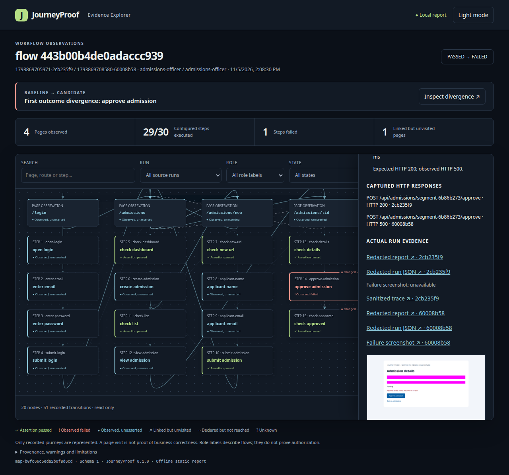
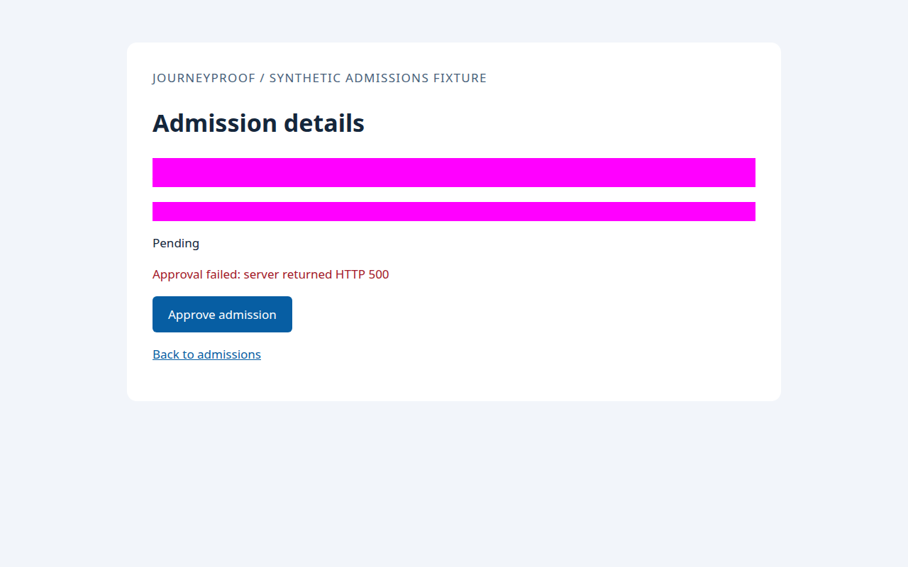

# JourneyProof

**Turn an explicit browser journey into reproducible pass/fail evidence.**

JourneyProof runs YAML workflows in Chromium, records what happened, and helps you compare a working flow with a regression. Use it from the CLI, TypeScript/JavaScript SDK, or a local MCP client. A portable Agent Skill guides coding agents through the same verification workflow.

**Release candidate: `0.1.0-rc.1` · Apache-2.0 · source checkout required.** npm and MCP Registry installation are unavailable. The package remains `private: true`; source licensing does not authorize publishing, registry submission, uploads or repository visibility changes.

[Quick start](#quick-start-from-source) · [Local demo](#a-local-demo-in-about-60-seconds) · [CLI](#cli) · [MCP](#mcp-server) · [Agent Skill](#agent-skill) · [SDK](#sdk) · [Security](#security-and-compatibility)

## What you can verify

- **Declared browser workflows:** navigate, fill, click, and assert visibility, text, URL or an HTTP response using seven supported YAML actions.
- **Local evidence:** JSON and offline HTML reports, masked failure screenshots, and minimized Playwright traces.
- **Workflow maps:** inspect recorded pages and steps, distinguish assertions from observations, and compare the first outcome divergence between compatible runs.
- **Editable regression tests:** generate Playwright tests from a definition or a verified run, review the output, then execute it separately.
- **One execution engine:** CLI, SDK, eight local stdio MCP tools and generated regressions share the same browser runner and security policy.

You choose the journey and its assertions. JourneyProof does not discover every bug, infer every business rule, crawl the whole app, or prove security/RBAC coverage. An AI agent may propose a journey or investigate a failure; that reasoning is separate from JourneyProof's recorded execution. A captured HTTP 500 is evidence of a failed expectation, not an automatic root-cause diagnosis. Human review remains necessary.

## See the evidence

Actual captures from the bundled **fictional admissions application**; no customer application or real applicant data is shown. These are illustrative earlier runs, not results for your checkout.



The comparison shows the same approval journey passing normally and failing when the fixture deliberately returns HTTP 500 instead of 200.



Screenshots mask known inputs but can still contain other page data. Inspect evidence before sharing it.

## Quick start from source

Requires **Node.js 24.11+ within Node 24**, npm, and Playwright's matching Chromium binary. Firefox and WebKit are unsupported. The shell examples below use POSIX syntax; [installation](docs/INSTALLATION.md) includes Windows guidance and compatibility limits.

```bash
git clone https://github.com/UsamaTahreemKhalid/journeyproof.git
cd journeyproof
npm ci
npx playwright install chromium
npm run build
node dist/cli.js doctor
```

With an existing checkout or source archive, start at `npm ci` in its root. On a supported Linux host missing system libraries, use `npx playwright install --with-deps chromium`; installing OS dependencies may require administrator privileges. Downloads and initial setup are outside the demo timing below.

## A local demo in about 60 seconds

After setup, run:

```bash
npm run demo:map
```

This existing demo starts fresh fictional applications on ephemeral loopback ports, runs healthy and intentionally broken approval flows plus a reviewer flow, builds offline maps, exercises MCP map retrieval, and stops its servers and browser. A deliberate application failure is expected; the demo command succeeds only when its checks pass. It needs no account, real credentials or external application.

Open the comparison HTML path printed at the end in your browser. Run IDs and paths are also saved in `.journeyproof/map-demo/manifest.json`; screenshots are under `.journeyproof/map-demo/screenshots/`. Generated evidence stays local and ignored by Git. Runtime varies by machine; 60 seconds is an onboarding target, not a deadline or installation-time guarantee.

For the longer installed-tarball check, `npm run demo:installed` builds and validates a temporary consumer, including generated tests. See [installation](docs/INSTALLATION.md).

## CLI

To run the journey yourself, start a fresh application in one terminal:

```bash
npm run demo
```

In a second terminal at the checkout root:

```bash
export JOURNEY_DEMO_EMAIL=officer@example.test
export JOURNEY_DEMO_PASSWORD=fictional-demo-password
node dist/cli.js run --flow examples/admissions-demo/journeys/happy-path.yaml --base-url http://127.0.0.1:4173 --json
```

These credentials are intentionally fictional. The JSON result includes status, step outcomes, a run ID and evidence paths. Exit codes are `0` for success, `1` for a failed journey and `2` for input/environment errors. Stop the fixture with Ctrl+C; restart before repeating a full journey because it mutates in-memory data. `npm run demo:broken` starts the deliberately failing version instead; stop the healthy server first.

Use `node dist/cli.js --help` for all commands and [CLI documentation](docs/CLI.md) for details. For your own app, `node dist/cli.js init` creates a commented example; see the [journey schema](docs/JOURNEY_SCHEMA.md) before editing it.

## MCP server

JourneyProof exposes eight tools over **local stdio**, with no HTTP server or model API dependency. Verify the protocol and synthetic healthy/broken journeys with:

```bash
npm run demo:mcp
```

For an MCP-capable client, adapt this configuration to your absolute checkout and application paths:

```json
{
  "mcpServers": {
    "journeyproof": {
      "command": "node",
      "args": ["/absolute/checkout/dist/cli.js", "mcp"],
      "env": {
        "JOURNEYPROOF_WORKSPACE_ROOT": "/absolute/application/workspace",
        "JOURNEYPROOF_FLOW_ROOT": "journeys"
      }
    }
  }
}
```

Create and review your approved `journeys/` folder first. To use the bundled demo, set the workspace to this checkout and the flow root to `examples/admissions-demo/journeys`; pass the fictional input variables from the CLI example through the host's environment. Start a fresh fixture separately. Host configuration formats differ; follow [MCP setup](docs/MCP.md) and [tool contracts](docs/MCP_TOOLS.md).

Use the absolute Node entry, not `npm run`, for stdio registration: npm banners would corrupt protocol stdout. MCP accepts **numeric loopback origins only** (`127.0.0.1` or `[::1]`), fixes workspace boundaries at startup, and runs one browser operation at a time. The draft identity `io.github.UsamaTahreemKhalid/journeyproof` is not a registry registration or install command.

## Agent Skill

The Skill supplies verification instructions to an agent; it does not install the MCP server or give permission to modify an application. From the checkout root, install a self-contained project copy for Codex:

```bash
mkdir -p .agents/skills
test ! -e .agents/skills/journeyproof && cp -R skills/journeyproof .agents/skills/journeyproof
```

The guard preserves any existing installation. Restart the host and check skill discovery before using `$journeyproof`. Claude Code uses `.claude/skills/journeyproof/`; see [Skill installation](docs/AGENT_SKILL.md) for both hosts, PowerShell copy guidance and validation limits. Copied-file tests do not prove a host/model session will select the Skill.

## SDK

From the built checkout root, with a **fresh** `npm run demo` server, run this self-contained shell example:

```bash
node --input-type=module <<'JS'
import { loadJourney, runJourney } from "./dist/index.js";

const loaded = await loadJourney(
  "examples/admissions-demo/journeys/happy-path.yaml",
);
const { run, paths } = await runJourney({
  ...loaded,
  baseUrl: "http://127.0.0.1:4173",
  env: {
    JOURNEY_DEMO_EMAIL: "officer@example.test",
    JOURNEY_DEMO_PASSWORD: "fictional-demo-password",
  },
});
console.log(run.status, run.id, paths.html);
if (run.status !== "passed") process.exitCode = 1;
JS
```

The SDK shares the CLI's origin guard and evidence pipeline. [SDK documentation](docs/SDK.md) covers source and local-tarball imports; no registry installation is required for this example.

## Workflow maps and regression generation

After `npm run demo:map`, use its actual saved baseline to build a map and preview an editable test:

```bash
RUN_ID=$(node -p "require('./.journeyproof/map-demo/manifest.json').healthy.runId")
node dist/cli.js map --run "$RUN_ID" --json
node dist/cli.js generate-test --run "$RUN_ID" --dry-run --json
```

Preview does not execute a browser or write a test. Review the generated code and required environment bindings before explicitly writing and running it. `npm run demo:regression` demonstrates generation, typechecking, and execution of the same generated file against fresh healthy/broken fixtures. Generated execution is Chromium/numeric-loopback only.

Maps describe recorded observations; an unvisited link is not a tested page, and a visited page is not necessarily asserted. See [workflow maps](docs/WORKFLOW_MAPS.md), [regression generation](docs/REGRESSION_GENERATION.md) and [declared-workflow coverage](docs/WORKFLOW_COVERAGE.md).

## Security and compatibility

Use authorized disposable applications and synthetic data. Journeys can submit forms and change application state.

- **One approved origin per run.** Tested Chromium interception blocks forbidden document navigation and redirect destinations before request dispatch. Same-origin redirects and SPA history transitions are supported. CLI/SDK remote targets need explicit opt-in and operator authorization; that never approves additional origins.
- **Strict application compatibility.** Cross-origin images, fonts, scripts, styles and fetch/XHR are unsupported. There is no multi-origin allowlist. Popups and WebSockets are blocked; Service Workers are disabled. Interception unavailability fails closed.
- **A bounded security boundary.** This is not universal network isolation, an OS sandbox, DNS-rebinding protection or protection against browser exploits. Arbitrary trusted SDK callbacks and the target server's own network activity are outside the guard.
- **Local evidence, manual review.** No telemetry or automatic upload; MCP clients may forward summaries according to their own settings. Known-input masking is incomplete privacy protection. Minimized traces omit network payloads and DOM snapshots; abrupt termination can leave temporary evidence behind.
- **Platform scope.** The latest hosted main CI passed all seven jobs, including browser tests on Linux/Chromium and portability jobs on Linux, macOS and Windows. The portability jobs do not test browsers or establish Windows/macOS browser support; see the [compatibility table](docs/INSTALLATION.md#compatibility-and-validation-scope).

Read the [security model and result codes](docs/SECURITY.md) before testing another application. Report vulnerabilities privately using [SECURITY.md](SECURITY.md).

## Contributing and support

Read [Contributing](CONTRIBUTING.md), the [Code of Conduct](CODE_OF_CONDUCT.md), [Support](SUPPORT.md) and [Troubleshooting](docs/TROUBLESHOOTING.md). Support is best effort with no guaranteed response time. Share minimal fictional reproductions and reviewed evidence.

Contributors can run:

```bash
npm run ci
npm run test:platform
npm run check:release-policy
```

CI checks formatting, lint, types, coverage, browser tests, demos and the installed package. Release validation never authorizes publication.

## License

JourneyProof source is licensed under [Apache License 2.0](LICENSE). See [NOTICE](NOTICE) for attribution information. npm distribution, MCP Registry registration and repository visibility remain separate owner decisions.
